<div align="center">



<br>

Agent skills for running coding agents in parallel without collisions, writing plans that say who owns which file, and closing sessions cleanly.

<br>

[](https://github.com/vgozalov/skills/actions/workflows/test.yml)
[](./LICENSE)
[](#install)
[](#development)

<a href="#install"><b>Install</b></a>&nbsp;&nbsp;&nbsp;&nbsp;
<a href="#the-skills"><b>Skills</b></a>&nbsp;&nbsp;&nbsp;&nbsp;
<a href="#parallel-waves"><b>Parallel waves</b></a>&nbsp;&nbsp;&nbsp;&nbsp;
<a href="#why-this-repo-exists"><b>Why</b></a>&nbsp;&nbsp;&nbsp;&nbsp;
<a href="#how-installing-works"><b>How it works</b></a>&nbsp;&nbsp;&nbsp;&nbsp;
<a href="#faq"><b>FAQ</b></a>

</div>

<br>

Every skill here is a plain `SKILL.md` folder with a name of its own, so it installs next to anything else you use and replaces nothing. The [`skills`](https://www.npmjs.com/package/skills) CLI puts one copy where Codex reads it and a symlink where Claude Code reads it.

## Install

Pick the one that fits. None of them need a clone.

### Just these skills

```bash
npx skills@latest add vgozalov/skills -a claude-code -a codex
```

Swap in any agent the `skills` CLI supports (`cursor`, `opencode`, `windsurf`, `amp`, and more), or omit `-a` to choose interactively. `wrap-up`, `create-sprint` and `parallel-briefs` work on their own. `parallel-plans` and `parallel-agent-development` work as a pair, and they also load skills by name for git worktrees, code review and finishing a branch, so have skills with those jobs installed too.

### A whole repo from a manifest

For repos that pull skills from several sources, list them in `.agents/skills.txt` and let `install.sh` install them in the right order:

```
# source                  skills ("*" = all)
anthropics/skills         frontend-design webapp-testing
vgozalov/skills           *
```

Then, from the repo root, run the script straight from GitHub (add `-s -- --dry-run` after `bash` to preview), or from a clone with `<clone>/install.sh`:

```bash
curl -fsSL https://raw.githubusercontent.com/vgozalov/skills/main/install.sh | bash
```

It installs every line for Claude Code and Codex, installs `vgozalov/skills` last whatever its position in the file, pins the CLI to `skills@1.7.2`, and turns off the CLI's telemetry. [More in how installing works](#how-installing-works).

<details>
<summary><b>Then add the instructions block</b> to <code>AGENTS.md</code> (with <code>CLAUDE.md</code> symlinked to it)</summary>
<br>

```markdown
## Skills

Skills live in `.claude/skills/` (Claude Code) and `.agents/skills/` (Codex).
Before any task, including questions, check whether a skill applies. If one
plausibly does, load it and follow it.

## Skill paths

- specs: context/specs
- plans: docs/plans
- memory: context/memory
- learnings: context/learnings.md
- sprints: sprints
```

Adjust the paths to your repo. `wrap-up` and `create-sprint` read them, and ask once when a key is missing.

</details>

<details>
<summary><b>Commit what was installed</b></summary>
<br>

Commit `.agents/skills/`, the `.claude/skills/` symlinks, `skills-lock.json` and, if you use one, `.agents/skills.txt`. Teammates and CI then get exactly the same skills without installing anything.

</details>

<details>
<summary><b>Update</b></summary>
<br>

```bash
npx skills@1.7.2 update -p -y    # this repo
npx skills@1.7.2 update -g -y    # global skills
```

`update` re-fetches changed skills, keeps pinned tags, and keeps each skill tied to its source, so these skills keep updating from this repo.

</details>

<details>
<summary><b>Global document skills</b>, available in every repo</summary>
<br>

```bash
npx skills@latest add anthropics/skills -g -s docx pdf xlsx pptx doc-coauthoring skill-creator -a claude-code -a codex -y
```

or the manifest version, which installs [`global.txt`](./global.txt): those six plus `claude-md-improver` and `claude-automation-recommender`.

```bash
curl -fsSL https://raw.githubusercontent.com/vgozalov/skills/main/install.sh | bash -s -- --global
```

</details>

## The skills

| Skill                                                                                                                                                          | What it does                                                                                                                                                                                         |
| :------------------------------------------------------------------------------------------------------------------------------------------------------------- | :--------------------------------------------------------------------------------------------------------------------------------------------------------------------------------------------------- |
| <br>[**parallel-plans**](./skills/parallel-plans/SKILL.md)                                     | Turns a spec into a task-by-task plan. Each task declares the files it **owns**, and the plan lists the files frozen while tasks run in parallel.                                                    |
| <br>[**parallel-agent-development**](./skills/parallel-agent-development/SKILL.md) | Runs a plan through implementer and reviewer subagents. Tasks that touch different files run **in parallel waves** in one worktree, and `ownership-check` rejects any commit outside a task's files. |
| <br>[**parallel-briefs**](./skills/parallel-briefs/SKILL.md)                                  | Splits work across several agents outside a plan. Each gets a brief: your files, do not touch, read first, and what to do when shared code is missing.                                               |
| <br>[**wrap-up**](./skills/wrap-up/SKILL.md)                                                          | Ends a session: feedback, learnings, the day's memory file, a one-line "Last Session" pointer, and the docs commit.                                                                                  |
| <br>[**create-sprint**](./skills/create-sprint/SKILL.md)                                        | Turns a written plan into a verification sprint, a `prod.json` acceptance harness, from its bundled example.                                                                                         |

## Parallel waves

Running several implementer agents at once is the obvious speed-up. It's also how you get two agents editing the same registry, or one agent's `git add -A` sweeping up another's half-written files.

`parallel-plans` makes every task declare what it owns. `parallel-agent-development` dispatches up to four tasks at once when their files don't overlap, then checks every commit before the next wave starts.

<p align="center">

</p>

A plan declares ownership like this:

```markdown
## Parallel layout

Frozen during waves: `src/registry.ts`, `package-lock.json`

### Task 2: Feature A

**Owns:** `src/feature-a/**`

### Task 3: Feature B

**Owns:** `src/feature-b/**`
```

When an agent strays, `ownership-check` names the commit, the file, and the likely cause:

```console
$ bash scripts/ownership-check plan.md BASE HEAD 2,3
2fcef57 src/registry.ts: frozen during waves
2fcef57: spans tasks 2 and 3
2fcef57: looks like an auto-commit Stop hook ran mid-wave
```

If an agent needs shared code that doesn't exist yet, it writes it in a file it owns and reports it as _proposed for shared_. An integration task folds those proposals in once the wave is done, so no agent ever waits on another.

> [!NOTE]
> This repo was built this way: two parallel waves of four and two implementers, every wave ownership-clean.

## Why this repo exists

| The problem                                                                                                                  | The fix                                                                                                                                 |
| :--------------------------------------------------------------------------------------------------------------------------- | :-------------------------------------------------------------------------------------------------------------------------------------- |
| **Parallel agents step on each other.** Shared registries get edited twice, and one agent's commit sweeps up another's work. | Each task owns its files, shared files are frozen during a wave, and `ownership-check` fails any commit that crosses a line.            |
| **Skills drift between repos.** Three repos end up with three different `wrap-up`s.                                          | One source of truth here. Repos install from it and update with one command, and every change arrives as a diff.                        |
| **Skills assume one repo layout.** A skill that hardcodes `context/memory/` breaks everywhere else.                          | Paths live in each repo's `AGENTS.md` under `## Skill paths`. The skills read them, and ask when one is missing.                        |
| **Customizations vanish on plugin updates.** Edit a skill in a plugin's cache, and the next version replaces it.             | Customized skills live here under names of their own and install with one command, so an update of anything else never overwrites them. |

## How installing works

<p align="center">

</p>

When two sources ship a skill with the same name, the one installed last replaces the other: its folder and its `skills-lock.json` entry. One copy remains. That's why `install.sh` installs this repo last: a customized copy hosted here takes the place of the original it was made from.

A few rules keep this predictable:

- **Never edit installed copies.** `update` overwrites local edits without warning. Change a skill here, or host a customized copy of someone else's.
- **Keep one scope per skill name.** Claude Code prefers the personal (`~/.claude/skills`) copy over the project one, and Codex shows both. Install each skill at one scope.
- **Pin with `#tag`, never `@tag`.** The CLI silently ignores `owner/repo@tag` and installs the latest version.
- **Watch for built-in names.** A project skill named `code-review` replaces Claude Code's built-in `/code-review`.
- **Removing doesn't happen by itself.** Deleting a manifest line leaves the skill installed. Run `npx skills@1.7.2 remove <name> -y`.
- **Same-named folders get replaced.** Installing a skill replaces an existing `.claude/skills/<name>` folder, so a local untracked skill with that name is lost.

<details>
<summary><b>install.sh flags and settings</b></summary>
<br>

- `--dry-run` prints the CLI commands instead of running them.
- `--global` installs [`global.txt`](./global.txt) at user scope: `~/.agents/skills/`, symlinked from `~/.claude/skills/`.
- `SKILLS_CLI`, `HOSTED_SOURCE` (default `vgozalov/skills`) and `MANIFEST` override the CLI command, the source installed last, and the manifest path.
- The hosted line is recognised in any common spelling (`https://github.com/vgozalov/skills`, `.git`, `git@github.com:vgozalov/skills.git`, `github:vgozalov/skills`, a trailing `/`, with or without `#ref`), and is passed to the CLI exactly as written.
- If the script fails part-way, run it again before committing, because some skills may still be the copies from another source.

</details>

## FAQ

<details>
<summary><b>Why not a Claude Code plugin?</b></summary>
<br>

Plugin skills are namespaced (`my-plugin:wrap-up`), so they never take the place of a same-named skill from another source. Plugins also update themselves, and a plugin is Claude-only. Installing with `skills` gives one copy of each skill, under its plain name, for every agent, and updates only when you run `update`.

</details>

<details>
<summary><b>Why have install.sh if npx works?</b></summary>
<br>

For one or two sources, plain `npx` is all you need. The script earns its place when a repo pulls from several sources: it reads one file, installs everything for both agents in the right order, pins the CLI version, and turns off telemetry.

</details>

<details>
<summary><b>Does it work with Cursor, OpenCode or other agents?</b></summary>
<br>

The skills are plain `SKILL.md` folders, so any agent the `skills` CLI supports can install them with `-a <agent>`. They're written and tested against Claude Code and Codex. `parallel-agent-development` needs an agent that can dispatch subagents.

</details>

## Development

```bash
bash tests/run.sh
```

This runs every `tests/*.test.sh`, then shellcheck over the scripts. [CI](https://github.com/vgozalov/skills/actions/workflows/test.yml) runs it on Linux with bash 5 and on macOS with `/bin/bash` 3.2, the version every script has to support.

The art (the banner, the skill emblems and the two diagrams) is drawn by [`assets/generate.py`](./assets/generate.py). It needs `fonttools`, downloads its three typefaces once into `assets/.fonts/` (pinned and checked against a SHA-256), and turns all text into outlines so the SVGs look the same everywhere:

```bash
pip install fonttools && python3 assets/generate.py
```

## Licenses

MIT. See [`LICENSE`](./LICENSE).

Third-party notices are in [`LICENSES/`](./LICENSES), and a copy ships inside each skill that includes one, so it travels with every install. Skills installed from other sources keep their own licenses and are never committed here. Anthropic's `docx`, `pdf`, `xlsx` and `pptx` are only ever installed from their source. The art uses Instrument Serif, Instrument Sans and IBM Plex Mono (SIL Open Font License 1.1); only their outlines appear in the SVGs.
